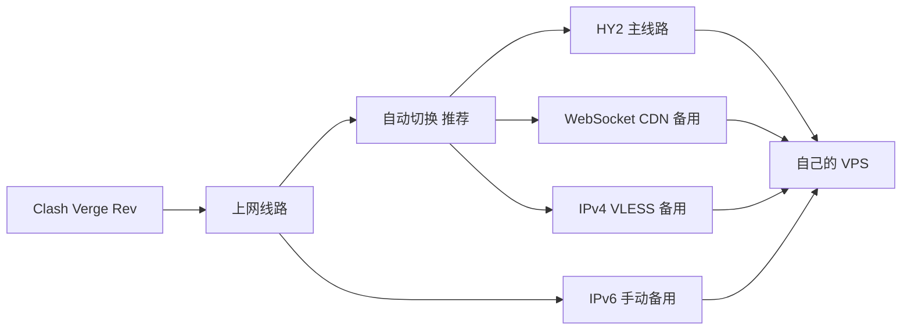

# VPS 自建代理指南：Hysteria2 + VLESS + Clash Verge Rev

[简体中文](README.md) · [English](i18n/README.en.md) · [日本語](i18n/README.ja.md) · [한국어](i18n/README.ko.md) · [Español](i18n/README.es.md) · [Français](i18n/README.fr.md)

一份自建 VPS 代理教程，涵盖服务器选择、部署、Clash Verge Rev 配置与排障。让你的 AI Agent 先阅读 [README.md](README.md) 和 [AGENTS.md](AGENTS.md)，再根据你的网络条件与服务器情况，分阶段引导搭建和验证。

仓库仅提供示例配置，需要使用你自己的服务器和账号。

## 成都移动宽带，日常使用近三个月

我从 2026 年 8 月开始使用这套 RackNerd VPS 方案，至今仍在使用。这份教程来自近三个月的实际使用、排障和持续完善，帮你从准备服务器走到客户端连接。

记录确认 2026 年 8 月 14 日移动宽带下已可用；截至 2026 年 11 月 4 日，时间跨度为 82 天。

这段时间也遇到过掉线和 DNS／客户端配置问题，并做过排查和维护。因此，这里记录的是使用经历的时间跨度，不是连续 82 天零故障，也不保证其他网络有相同表现。

如果你也在成都、使用移动宽带，这个经历可以作为参考；其他地区、运营商和机房的表现仍需按你的实际网络验证。已有合适 VPS 可以直接试着部署，不必为了跟教程另买一台。

> 验证范围：以上是作者本人提供的使用经历；公开版教程尚未在一台全新 VPS 上从头完整复现。文档和模板已完成离线检查，发布记录见 [发布状态](docs/release-status.md)。

## 搭好以后，可以用来做什么？

可以用自己的线路搜索海外资料、查阅技术文档、观看视频，以及连接 Codex 等 AI 工具。下面是 2026-11-04 在作者现有 Mac、Chrome 和自建 HY2 线路上的实际检查：

| 用途 | 本次实际结果 |
| --- | --- |
| Google 搜索资料 | 已输入查询并返回搜索结果 |
| YouTube 看视频 | 首页、视频页加载成功，正片播放进度到约 20 秒 |
| Codex 编程工作入口 | 已进入登录后的工作界面，显示输入框、模型与环境选择；本次未提交编程任务 |
| TikTok | 网站可达，但进入登录／生日验证流程；未验证视频浏览、发布或手机 App |

连接记录确认上述测试域名经过当前自建 HY2 线路。这是当前设备与线路的使用样例，不代表其他机房、运营商或所有服务都能使用，也不是长期稳定性测试。部署后请在自己的设备上逐项验证需要的功能；网站可达不等于账号资格或全部功能可用。

## 先判断是否需要购买

| 用途 | 入口 | 如何选择 |
| --- | --- | --- |
| VPS 服务器 | [RackNerd 推广链接](https://my.racknerd.com/aff.php?aff=21220) | 作者实际使用的服务商之一；先按下方清单判断是否适合，再查看当前套餐 |
| 本地客户端 | [Clash Verge Rev 官方下载](https://github.com/clash-verge-rev/clash-verge-rev/releases) | 在自己的电脑安装，选择对应系统和 CPU 架构的稳定版安装包 |

客户端名称为 **Clash Verge Rev**。下载页提供 Windows、macOS 和 Linux 版本；安装包与系统、架构的对应关系以官方发布页为准。

*通过上方 RackNerd 推广链接购买，我可能会获得佣金，用于维护教程。推广链接不代表买家一定获得额外折扣，价格与优惠以结算页面为准。*

### 没有 VPS，先看这份选购清单

- **先确认自己需要什么**：愿意自己维护 Linux、更新软件和排查网络，再考虑自建。服务器购买后不会自动变成可用节点；本教程不含代部署或售后运维。
- **从小配置评估**：个人轻量使用可从 1 vCPU、1 GB 内存的 KVM VPS 级别比较；面板和多人使用另核对资源需求，不把配置大小当作网速保证。
- **比较完整费用**：看清月付还是年付、首期总价、续费价、流量及超额规则、IPv4 和域名费用。不同入口的常规套餐与活动套餐可能不同，不直接照抄旧促销价。
- **先看网络和退款条件**：确认地区、UDP、测试方式与退款限制。官方条款不提供无条件退款保证，不要抱着“买错再退”的预期付款。

决定比较 RackNerd 时，可以[通过作者推广链接查看当前套餐](https://my.racknerd.com/aff.php?aff=21220)。这只是候选供应商，不保证适合你的运营商，也不保证额外折扣。先确认套餐与条款，再注册、付款；已有服务器可直接进入下方部署路线。

价格与规则以 [官方套餐](https://www.racknerd.com/kvm-vps) 和 [服务条款](https://www.racknerd.com/terms-of-service) 为准。选购细节见 [部署指南第 1 节](docs/deployment.md)。

## 适合谁

希望使用自己服务器的个人开发者、家庭用户，以及需要让 Agent 协助部署的读者。你需要自己的 VPS/域名、SSH 管理权限和客户端。软件模板可复用，服务器和域名费用由使用者自行承担。

## 选择适合自己的部署路线

| 目标 | 先读哪里 | 最终结果 |
| --- | --- | --- |
| 自己使用，直接维护服务配置 | [独立服务部署](docs/deployment.md) | HY2、CDN、IPv4 VLESS 与客户端自动回退 |
| 与家人朋友共享，分配独立订阅 | [3X-UI 家庭与朋友共享教程](docs/3x-ui-family-sharing.md) | 面板统一管理三条入站，每人独立身份、订阅、额度和有效期 |

多人共享时先选择面板路线，不要再同时安装独立服务占用相同端口。费用由成员自行约定，流量额度与共享带宽分开理解；跨协议统计、超额停用和完整撤销按新教程实测。已有服务的迁移也在该章节单独说明。

## 开始前先做这几件事

1. **先判断是否需要购买**：已有可用 VPS 就直接复用。没有服务器时，先按上方清单核对预算、线路和维护要求，再决定是否注册。
2. **购买前交给 Agent**：把仓库文件夹和下面的任务发给 Agent，结合 [参数表](docs/parameters.example.md) 核对预算、运营商、设备条件与候选套餐。
3. **确认后再购买**：由你核对总价、续费和退款条款，确认付款；等待 VPS 开通并验证 SSH 登录。
4. 从上方官方下载页准备 Clash Verge Rev，按选定路线完成多线路配置，再按 [验收与恢复](docs/verification.md) 验证；多人共享还需完成两名测试用户的统计、限额和撤销检查。

可以将下面这段任务连同仓库地址交给 Agent：

> 请先读 AGENTS.md、README.md，确认我是个人独立服务部署，还是家庭朋友共享的 3X-UI 面板部署，再按对应教程执行。目标是完成 HY2 主线路、VLESS/CDN 与 IPv4 VLESS 备用、Clash Verge Rev 自动切换及国内直连。先核对我的网络、服务器、域名、设备和已有服务，填写本地私密参数表。逐条部署并验证：HY2 成功是中间检查点，随后继续完成备用线路和切换验收。IPv6、多用户和远程订阅按实际需要启用；条件不足时记录缺口，不把单线路成功写成完整部署完成。保留自建线路的优先级回退策略，每一步备份并记录结果；已授权的步骤连续完成，涉及购买、账号验证或超出授权的操作时再由我确认。不要把密码、密钥或订阅链接发到聊天里。

## 最终配置与部署顺序

推荐完成三条自建线路：HY2 主线路、WebSocket CDN 备用和 IPv4 VLESS 备用。IPv6 验证可用后作为手动备用。公开方案使用自己的 VPS 和域名，无需另购 VPN 订阅。先测通 HY2 是为了分层定位问题，完整目标仍是多线路自动回退。

| 情况 | 当前脚本的行为 |
| --- | --- |
| 自建线路自动上网 | `fallback` 按 HY2 → CDN → IPv4 的顺序选可用线路，主线路仍可用但变慢时，不保证改选延迟更低的线路 |
| 手动选择 | 可直接选已验证节点；不会自动替换失效的手选节点，日常使用应切回自动 |

同一台 VPS 上的多种协议能提供不同连接路径，但共享服务器、出口等故障点；增加线路不等于服务器级容灾。完整步骤与验收见 [部署指南](docs/deployment.md) 和 [客户端故障切换](docs/client-failover.md)。

## 架构



国内服务及明确列出的例外按规则直连，其余进入代理组。当前脚本还将 `cloudflare.com`、`cloudflare-dns.com` 及其子域名设为 DIRECT；不表示全部 Cloudflare 托管网站都直连。具体以 [脚本规则](scripts/shared-profile.js) 和实际连接记录为准。自动回退按健康状态处理新连接，不保证重试已经失败的请求。IPv6 是否可用需要当地网络验证。

## 文件导航

| 入口 | 内容 |
|---|---|
| [AGENTS.md](AGENTS.md) | Agent 执行边界、部署阶段与验收标准 |
| [docs/deployment.md](docs/deployment.md) | 独立服务路线：VPS、HY2、VLESS、CDN 与客户端 |
| [docs/3x-ui-family-sharing.md](docs/3x-ui-family-sharing.md) | 面板路线：安装、入站、按人订阅、额度、撤销和迁移 |
| [docs/parameters.example.md](docs/parameters.example.md) | 使用者自己的部署参数 |
| [docs/verification.md](docs/verification.md) | 实测与恢复流程 |
| [docs/rebuild-runbook.md](docs/rebuild-runbook.md) | 安装映射、续期、多用户边界和恢复顺序 |
| [docs/faq.md](docs/faq.md) | 常见问题 |
| [docs/client-failover.md](docs/client-failover.md) | 自建线路回退、国内 DNS 和故障验收 |
| [templates/clash.example.yaml](templates/clash.example.yaml) | 四节点占位配置 |
| [scripts/shared-profile.js](scripts/shared-profile.js) | 自动组与国内分流脚本 |
| [llms.txt](llms.txt) | Agent 内容索引 |

## 离线验证

安装 Node.js 和 Python 3 后运行：

```sh
node --test tests/*.test.js
python3 tests/check_docs.py
python3 tests/check_copy.py
python3 tests/check_i18n.py
```

脚本会重建代理组和规则，仅适用于本仓库基础模板，不用于覆盖复杂机场订阅。所有 REPLACE_* 必须替换。模板保留证书校验，不包含账号或有效订阅。

## 版本与证据

更新日期：2026-09-28。本版本完成脚本回归、文档链接与模板隐私检查；服务器配置与真实流量仍由部署者验收。[变更记录](CHANGELOG.md) · [安全说明](SECURITY.md) · [MIT 许可证](LICENSE)

## 反馈与持续更新

如果哪一步看不明白、配置报错，或者你有更好的做法，欢迎 [提交 Issue](https://github.com/koi-lee/vps-selfhost-guide/issues)。写清楚卡在哪一步、原本想得到什么结果、实际出现了什么，我会按反馈继续改。

提交前请隐藏密码、密钥、订阅链接及截图中的个人信息。纠错、补充经验和分享教程，同样是对项目的支持。

更多项目见 [koi-lee 的 GitHub 主页](https://github.com/koi-lee)。

## 支持教程更新

如果这份教程对你有帮助，欢迎自愿支持后续维护。教程免费开放，支持与否不影响使用和反馈问题。扫码后按支付 App 的提示完成即可。

<a href="SUPPORT.md"></a>
<a href="SUPPORT.md"></a>

[查看大图和其他语言说明](SUPPORT.md)

## 多语言范围

六种语言提供入口和核心操作指引；详细部署、恢复与验收文档目前以中文为维护源。其他语言可让 Agent 按原文解释，不代表所有文档已翻译。译文由 AI 辅助完成，尚未经过母语者校对。共用代码、占位符和代理组标识，不维护六套配置。默认分流面向中国网络，其他地区需核对路由策略。维护方式见 [翻译维护](i18n/MAINTENANCE.md)。
